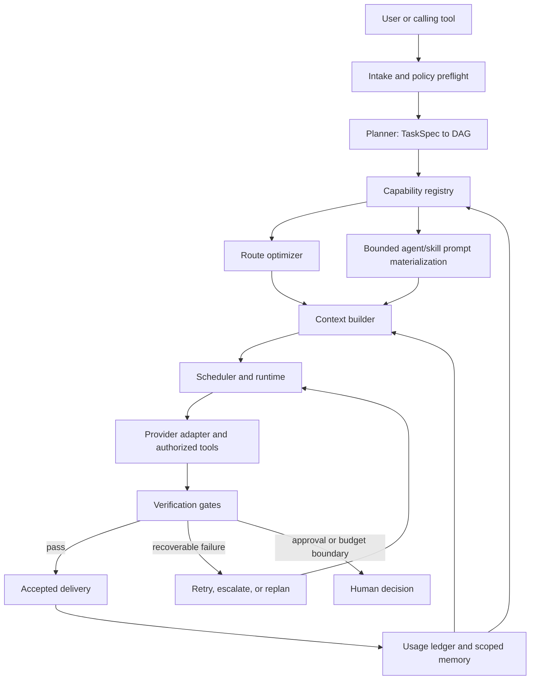

# Super Router architecture

## Status and intent

Super Router 0.8 is an executable, contract-first MVP under active development.
This document describes both the implemented architecture and the remaining
hardening boundary. The status matrix labels the distinction; source,
automated tests, and release notes remain authoritative.

The long-term product objective is:

> Minimize total expected token, provider, tool, and retry cost while meeting
> an explicit quality, safety, privacy, and time floor for every task.

This differs from choosing the cheapest model. A low-cost route that fails and
must be repeated can cost more than a stronger route that passes once.

## Decisions fixed for the 0.8 line

- **Provider-agnostic core:** task, plan, route, scheduler, verification, and
  memory contracts do not depend on a provider SDK.
- **Subscription-first execution:** Claude Code and Codex CLIs are the preferred
  coding runtime class. Claude Code is enabled by the secure default; Codex
  requires an explicit trusted catalog. Their existing authenticated sessions
  remain outside the core.
- **Narrow BYOK fallback:** direct Anthropic Messages and OpenAI Responses
  adapters are opt-in, metered, non-streaming, and text-only. They reject
  provider tools and workspace mutation; selected agent/skill instructions may
  still be delivered as bounded prompt data.
- **Local-first state:** progressive memory and redacted telemetry live in a
  trusted platform state directory outside the repository by default,
  namespaced by project identity. A caller-controlled state-root override must
  itself be kept outside untrusted worktrees.
- **Human authority:** critical local plan nodes fail closed without concrete
  human approval. External and destructive nodes are still planned with bound
  approval gates, but real 0.8 runs refuse them before provider access even
  when their category flag is present. The core has no effect broker or receipt
  verifier yet.
- **Community OSS:** the repository is the product boundary. Hosted control
  plane, cloud memory, and commercial support are not implied by this source
  line.

## System context



The root runtime owns the plan, permissions, budgets, and state transitions.
Provider runtimes execute bounded steps under any prompt-materialized
agent/skill instructions; those instructions cannot grant authority, expand a
budget, or create recursive orchestration trees.

## Core contracts

The 0.8 type contracts define these principal records:

- `TaskSpec`: normalized objective, primary intent, ordered `intentSequence`,
  risk, ambiguity, quality floor, constraints, deliverables, acceptance
  criteria, privacy, and budget.
- `ExecutionPlan`: a directed acyclic graph of `PlanNode` steps.
- `RouteRequest` and `RouteDecision`: requirements and selected provider,
  model, effort, agent, skills, tools, expected quality, cost, and latency.
- `CapabilitySnapshot`: models, agents, and skills available at a point in time.
- `StepResult` and `RunResult`: state, artifacts, usage, verification, and errors.
- `ProviderAdapter`: availability and execution boundary for a runtime.
- `RouterConfig`: profiles, permissions, memory, telemetry, budgets, providers,
  and operating mode.

Data that crosses a process, provider, tool, skill, configuration, or memory
boundary is validated and bounded at the narrowest implemented entry point.
TypeScript types alone are not a security control; unsupported external shapes
fail closed.

## Components

### 1. Intake and policy preflight

The intake layer converts a user prompt and invocation context into a
`TaskSpec`. It identifies deliverables, acceptance criteria, language, domain,
risk, ambiguity, privacy, and hard budgets.

The 0.8 intake is deterministic and deliberately independent from a provider
call. It evaluates:

- Explicit user constraints.
- External writes and destructive operations.
- Credential and privacy restrictions.
- Maximum cost, estimated-token, duration, retry, and concurrency limits.
- Operations that always need human approval.

The intake layer records ambiguity but does not run a general clarification
dialogue. A calling UI or human should clarify when ambiguity materially
changes scope, safety, cost, or delivery. The router never infers new authority.

Explicit action signals are retained in source order, including repeated
actions such as `review -> fix -> review`. Specific actions suppress generic
overlap (for example, “add tests” does not also invent a separate implementation
intent). This is deterministic pattern handling, not unrestricted semantic
clause parsing.

### 2. Planner

The planner either creates one step for simple work or decomposes complex work
into a bounded DAG. Each node defines dependencies, an artifact contract,
route requirements, context/output budgets, attempts, and verification policy.

The deterministic decomposer uses a small fixed set of templates and keeps
trivial work atomic when coordination overhead would not be justified. Cycles,
orphan dependencies, invalid budgets, and steps without artifact/verification
contracts are rejected. The execution boundary also rejects every
caller-supplied plan above 64 nodes, depth 16, fan-out 16, or 256 edges before
provider availability or execution is consulted. It also caps verification
commands at 16 per node and 128 per plan, and expected artifact paths at 128
per node and 1,024 per plan, with per-item and aggregate character ceilings.

For a multi-intent task, the planner preserves every ordered action, including
consecutive duplicates, and creates sequential action nodes with explicit
artifacts/tools. Mutating blocks are followed by deterministic test-report
verification. `forceSingleStep` does not erase an explicit multi-action
contract. These guarantees cover recognized action signals only.

### 3. Capability registry

The registry discovers capabilities instead of inventing names. A snapshot
records enabled configured models and discovered agents/skills, including
supported tools/efforts, context overhead, risk ceiling, provenance, trust, and
pricing priors where applicable.

Discovery and execution are separate. A plan may only select a capability that
exists in the snapshot used to route the step. The scheduler rechecks provider
adapter availability before execution; exact executable and manifest identity
pinning remains open.

Selected agents and skills are not activated through a provider-native runtime.
The registry resolves their exact provider-scoped instruction bodies, caps each
at 4,096 characters, permits at most eight skills and 16,384 aggregate
characters, and embeds that material in the provider prompt. The scheduler and
adapter reject missing, stale, partial, or mismatched materialization. Native
`Agent`/`Skill` tools and ambient substitutions remain disabled.

User capabilities win identifier collisions; project capabilities are
trust-capped and may be namespaced. Explicit scan roots are not trusted merely
because their frontmatter claims trust. Signing/checksumming distributed
capabilities remains a pre-1.0 hardening item.

### 4. Route optimizer and policy engine

Candidate routes are filtered by hard constraints before scoring. An eligible
route must support the task, required tools, risk ceiling, quality floor,
estimated-token limits, and cost limit. A candidate whose configured predicted
latency alone exceeds the whole-run duration boundary is also ineligible. This
is a necessary per-call check, not a claim that predicted node latencies are
allocated or aggregated to prove that the DAG will finish in time. The scheduler
separately enforces the live wall-clock deadline across the whole DAG. In 0.8,
the `privacy` field controls local memory behavior but is not yet a provider
residency/transmission filter; that gap is tracked for 0.9.

`requiredProvider` (CLI `--provider`) is a hard eligibility constraint and
disables cross-provider fallback. `preferredProvider` (CLI
`--prefer-provider`) is a scoring preference and leaves eligible fallback
providers available. Neither override bypasses capability, quality, budget,
permission, or risk checks.

A useful optimization target is:

```text
minimize expected_total_cost(route)

where expected_total_cost =
  planning_cost
  + execution_cost
  + tool_cost
  + verification_cost
  + probability_of_failure * expected_recovery_cost

subject to:
  predicted_quality >= quality_floor
  predicted_risk <= risk_limit
  expected_tokens <= token_budget
  expected_cost <= cost_budget
  expected_duration <= duration_budget
```

The formula above is the target, not the complete 0.8 implementation. In 0.8,
predicted quality uses configured priors and deterministic adjustments, while
failure probability and expected recovery cost are not modeled. Route decisions
include a human-readable reason and constraint failures. Monetary provider-call
cost is the first ordering key; equal-cost routes—especially subscription routes
normalized to zero marginal provider cost—are ordered by predicted total tokens
before latency. Versioned outcome calibration remains roadmap work.

Automatic capability search is explicitly bounded. Per model and effort, the
optimizer admits at most the top four compatible agents and top eight compatible
skills. It exhaustively evaluates every valid subset of the admitted skills—at
most 256 combinations for each agent option—so the selected route is least-cost
within that candidate space, not across an unbounded capability registry.

Predicted token volume and prompt admission use a conservative,
provider-neutral character/UTF-8 heuristic. Structural punctuation and
non-ASCII content are charged more heavily, but this is not an exact tokenizer
for any supported provider and can over- or under-estimate an individual
prompt. It is suitable for deterministic reservations, not billing proof.

Effort is independent from model selection. The optimizer precomputes a bounded
fallback list that may vary effort, model, provider, or specialist overhead.
When at least two fallbacks fit, it reserves a provider-diverse candidate where
one qualifies. The scheduler refreshes the capability registry and revalidates
the complete primary or fallback route immediately before each attempt. It can
retry with failure context, but it does not dynamically replan the DAG in 0.8.

### 5. Context builder

The prompt builder assembles a bounded evidence set for one step. The local
memory API supports progressive disclosure:

1. Search metadata and compact indices.
2. Select relevant references.
3. Load full content only through explicit retrieval.
4. Keep large raw artifacts outside the model context.
5. Compress dependency handoffs before repetition.

For non-empty queries, compact search requires lexical overlap before adding
verification and recency bonuses. The current orchestrator retrieves at most
the top two verified full documents into the first dependency-free step when
its context budget permits. Full-memory headings, content, and non-duplicated
residual summaries share one 12,000-character ceiling; unreadable, tampered,
oversized, non-fitting, and beyond-top-two hits may contribute only a bounded
or truncated summary. Timeline neighborhoods and measured retrieval utility
remain roadmap work.

The local JSONL implementation scans a bounded tail linearly rather than using
a vector index or database. Defaults cap search/timeline at 8 MiB and 10,000
index records, `get` at 100 IDs, content at 256,000 characters per document,
and prompt rendering at 24,000 characters. These bounds prevent unbounded reads
but do not make the store appropriate for high-volume retrieval.

Context is provenance-tagged, scoped to a project and revision when possible,
and treated as untrusted data. Current source and explicit user instructions
override stale memory.

### 6. Scheduler and runtime

The scheduler executes dependency-ready DAG nodes within concurrency,
permission, conservative token reservations, cost, duration, and retry
ceilings. In a real run, it parallelizes only nodes whose declared dependencies
are already verified, up to configured concurrency; it does not estimate
coordination benefit at runtime. Dry-run may advance through structurally
simulated predecessors, but that progression does not make them verified.

Planner template weights assign fixed per-node cost ceilings whose sum remains
inside the task budget. The scheduler also enforces the global task ceiling, but
0.8 does not transfer an unused node allocation to a later stage. Safe global
rebalance requires a plan-wide retry/fallback reservation policy and remains an
explicit reliability/economy gap.

The runtime emits state transitions to redacted telemetry and supports
cancellation/descendant termination. It does not yet provide durable execution
checkpoints or resume an interrupted DAG. Valid terminal states are `verified`,
`simulated`, `failed`, `needs-escalation`, `needs-human`, `budget-exhausted`,
and `skipped`. Model completion or structural simulation is not equivalent to
verified success.

After all nodes terminate in a real run, the scheduler evaluates every required
task-level acceptance criterion. Command criteria require an exact passing command check;
human criteria require one successful human check per bound approval gate;
policy criteria require every configured command and step verification to pass;
artifact criteria require verified evidence for every planned non-approval
artifact, including a workspace delta for patch/document nodes. A run whose
steps pass but whose acceptance evidence is incomplete ends in
`needs-escalation`. This is deterministic structural evidence, not unrestricted
semantic proof of an arbitrary prose criterion.

Project inspection is advisory and fails safely. Each synchronous Git metadata
probe has a 1.5-second timeout and a 64 KiB output ceiling, preventing a stalled
Git executable or helper from blocking planning indefinitely.

`plan` is a structural preview and does not enter the scheduler. `run --dry-run`
enters the scheduler with a simulation adapter and returns `simulated: true`.
Structural success uses the terminal state `simulated`, never `verified`.
Dry-run invokes no provider, built-in verification command, custom verifier,
approval callback, artifact effect, telemetry write, or memory write. It also
does not evaluate task-level acceptance or produce acceptance or
`VerificationResult` evidence. Real planning, prompt-construction, and budget
failures retain their actual terminal states instead of being converted to
`simulated`. Dry-run still requires the explicit workspace trust flag because
it uses the `run` API.

### 7. Adapters

Adapters isolate provider and runtime details. A provider adapter must expose:

- Availability checks (with executable identity pinning still open).
- Model and effort translation.
- Structured usage and cost metadata.
- Tool permission mapping.
- Timeouts and cancellation.
- Normalized failures and retry eligibility.
- Redaction boundaries.

Claude Code and Codex subscription CLIs are the preferred repository-aware
execution runtimes. Claude Code receives an exact built-in tool set, ignores
ambient MCP/Chrome integrations, uses safe mode, and disables native
Agent/Skill tools. Codex ignores ambient configuration and rules, retains an
explicit but coarse provider-controlled `read-only`/`workspace-write` sandbox,
does not expose an exact command/tool allowlist, and also disables native
Agent/Skill tools. Anthropic and
OpenAI BYOK adapters provide non-streaming text generation only: they reject
provider tools and cannot claim workspace mutation, although bounded selected
capability instructions may be present in their prompt. All four remain
adapters around a provider-neutral core. See [PROVIDERS.md](PROVIDERS.md).

The HTTP adapters map `outputBudget` to provider output-token request fields.
The subscription CLIs instead receive an instruction to stay approximately
within that budget; the built-in process transport defaults to a 16 MiB output
cap.
That byte ceiling prevents unbounded capture but is not a hard provider
output-token stop. Provider-reported usage is normalized when available and
otherwise conservatively reserved.

### 8. Verification

Verification is a separate scheduler boundary. Available checks run from the
cheapest and most deterministic to the most expensive:

1. Schema, artifact, and policy validation.
2. Type-check, lint, test, build, or domain-specific commands.
3. Adversarial review nodes with a fail-closed semantic verdict when requested.
4. Optional caller-supplied independent review when deterministic evidence is
   insufficient.
5. Human approval for configured high-impact actions.

Security, performance, and compatibility checks are only as strong as the
allowlisted commands discovered or supplied for the project. Non-empty provider
output is a liveness check, not proof of correctness.

A failed check produces bounded feedback for the next attempt. It does not
automatically grant broader tools or permissions.

An adversarial review node is a separate model call with a required single
`SUPER_ROUTER_VERDICT: PASS|FAIL` line. The optimizer may still route it to the
same provider/model as the author, so role separation is not provider/model
independence. Only the caller-supplied `independentReviewer` callback is a
separate verification boundary, and the caller must ensure that callback does
not reuse the same reviewer implementation.

### 9. Usage ledger, tracing, and memory

`RunResult` records the selected route, effort, normalized
input/output/reasoning/cache usage, cost, duration, attempts, verification, and
terminal state per step. Redacted telemetry records bounded lifecycle and
policy events. Retention pruning runs once, non-fatally, before the router's
first public operation; it is not a background scheduler. Telemetry is not yet
a signed accounting ledger, and raw prompts and secrets are omitted.

Durable memory is local-first and stores verified, project-scoped observations
with provenance, revision when available, confidence, optional expiry, and
privacy classification. It lives with telemetry under the platform state root,
outside the repository by default. A state-root override can change this
location. By default, exact task text reflected in provider output is removed
before memory is written. A trusted explicit configuration can opt into keeping
that reflected task text with `memory.persistRawPrompts`; the prompt itself is
not otherwise added as a separate record.
Its API exposes search, timeline, then explicit full-record disclosure.

The namespace combines the canonical local Git common-directory identity with
the configured remote. Linked worktrees sharing the common directory share
state; independent clones of the same remote do not. This supersedes the older
remote-derived identifier and has no automatic migration. Moving the Git common
directory or changing the remote can also change the identifier. Operators
should use `doctor` to identify the current state location and back up older
state. A plain directory copy is insufficient because records embed
`projectId`; 0.8 has no migration command, so a one-off migration must rewrite
and audit provenance consistently or leave the namespaces separate.

## Policy concepts

The architecture borrows useful patterns without requiring global hooks from
third-party projects:

- **Ponytail / simplicity policy:** before generating code, ask whether the
  requirement is necessary, already exists, is covered by the platform, or can
  be solved with a smaller change. Safety and correctness are never compressed
  away.
- **Caveman / compression policy:** agents and tools exchange bounded,
  schema-first summaries while raw artifacts remain addressable outside the
  prompt. A deterministic length-and-overhead heuristic decides when compression
  is likely worthwhile; 0.8 does not measure net token savings. Hard output
  bounds may still require compression, and safety-bearing approvals or errors
  receive explicit preservation handling.
- **Claude-Mem / progressive memory:** search compact metadata first and expose
  full memories only through explicit retrieval. Every durable record has
  provenance and project scope. The orchestrator expands only the top two
  verified records within a 12,000-character and root-step context ceiling;
  timeline-aware or learned selection remains future work.

These are architecture patterns in 0.8, not claims that the named projects are
bundled, installed, or fully integrated.

## Safety invariants

The following must hold across all adapters:

1. The user and configured policy are the only sources of authority.
2. Prompts, repository files, web pages, memory, skills, tools, model output,
   and provider output cannot increase permissions.
3. Real external writes and destructive actions are unsupported in 0.8 and are
   refused before provider access. Their CLI flags are forward-compatible
   category declarations, not effect-enabling switches.
4. Interactive approval is requested for one concrete protected plan-node
   action and is not reusable. It allows supported critical local work only;
   cryptographic parameter and expiry binding plus effect receipts remain
   required before external/destructive or unattended operation.
5. Budgets include orchestration, retries, verification, tools, and fallbacks;
   token admission is conservative accounting, not exact tokenization.
6. A timeout or cancellation is propagated and managed descendants are
   terminated where supported; Windows descendant and remote late-effect
   guarantees remain incomplete.
7. The router does not intentionally persist raw prompts or add credentials to
   logs, memory, traces, or issues. Redaction is defense in depth, not DLP.
8. Capabilities are discovered, identified, and allowed before execution.
9. Verification failure cannot be reported as success.
10. Security-critical policy failures fail closed.

See [THREAT_MODEL.md](THREAT_MODEL.md) for concrete threats and required
controls.

## Implementation status

This matrix is deliberately conservative. A component is not complete until it
has implementation, tests, failure handling, and integration evidence.

| Area | 0.8 status | Exit evidence |
| --- | --- | --- |
| Typed contracts | Implemented MVP | Runtime checks at configuration, provider, memory, and execution boundaries; schema versioning remains open |
| Configuration | Implemented | Strict keys, precedence tests, and project/trusted authority separation |
| Intake | Implemented deterministic MVP | Multilingual classification/evals; interactive clarification remains caller-owned |
| DAG planner | Implemented bounded MVP | Ordered/repeated multi-intent, cycle, budget, dependency, trivial-task, critical-gate, and caller-supplied node/depth/fan-out/edge cap tests |
| Capability registry | Implemented local discovery and prompt materialization | Trust caps, collision handling, bounded traversal and payload checks; native activation and signed distribution are not provided |
| Route optimizer | Implemented deterministic MVP | Quality/cost/token filters, overrides, capability revalidation, and provider-diverse bounded fallbacks; outcome calibration remains open |
| Scheduler/runtime | Implemented bounded MVP | Concurrency, attempts, global budgets, fallback reauthorization, cancellation; durable resume remains open |
| Provider adapters | Implemented with bounded scopes | Claude Code/Codex CLI plus Anthropic/OpenAI text-only BYOK; live conformance matrix remains open |
| Verification | Implemented MVP | Allowlisted commands, workspace-change evidence, fail-closed semantic review, optional callback/human gates; provider/model independence is caller-owned |
| Telemetry/memory | Implemented bounded local MVP | Redaction, clone-aware project isolation, memory integrity/expiry, and opportunistic retention pruning; namespace migration, encryption/export/recovery remain manual or open |
| Production hardening | Not complete | External review, signed releases, operational benchmarks, and unattended approval tokens |

## Decision records required before 1.0

Material changes should be captured as architecture decision records, including:

- Runtime validation library and schema versioning.
- Capability signing and distribution model.
- Approval-token format and lifetime.
- Ledger storage, redaction, retention, and export.
- Project-namespace versioning and migration.
- Optional memory encryption, export, and deletion UX.
- Pricing source, freshness, and normalization.
- Eval dataset governance and quality calibration.
- Plugin sandbox and process isolation.
