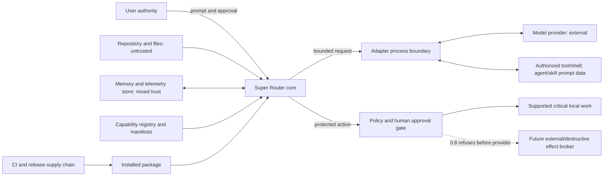

# Threat model

## Document status

This threat model covers the implemented Super Router 0.8 MVP and its remaining
hardening gaps. It is a living security document, not a certification. A
control is considered present only where source and tests enforce it; roadmap
language does not create a security boundary.

Last reviewed: 2026-08-01

## Security objectives

Super Router must:

- Preserve user intent and authorization across planning and execution.
- Prevent untrusted content from granting permissions or changing policy.
- Protect credentials, prompts, source, artifacts, memory, and telemetry.
- Enforce cost, duration, retry, concurrency, byte-output, and conservative
  token-accounting ceilings at their documented boundaries.
- Execute only identified, discovered, enabled, and compatible capabilities.
- Make external and destructive intents explicit and reviewable while refusing
  their real effects until enforceable mediation and receipts exist.
- Preserve evidence sufficient to explain a route and verify an outcome without
  logging sensitive raw content.
- Fail closed for security policy and fail transparently for quality or
  availability failures.

## Assets

- User authority and approval decisions.
- Local source files, worktrees, and generated artifacts.
- Provider and tool credentials.
- Private prompts and conversation context.
- Project and durable memory.
- Capability manifests, skills, agents, tools, and provider executables.
- Budgets and billing accounts.
- Route decisions, usage records, verification evidence, and audit events.
- CI, release, package, and update channels.

## Actors

- **User:** supplies goals, constraints, credentials, and approvals.
- **Maintainer:** publishes source, dependencies, workflows, and releases.
- **Contributor:** proposes code, docs, tests, or configuration.
- **Provider/tool operator:** processes selected data and returns untrusted
  output.
- **Repository author:** may control files containing adversarial instructions.
- **Capability author:** may publish a malicious or compromised skill, agent,
  tool, package, or executable.
- **Remote attacker:** attempts to exploit exposed inputs or dependencies.
- **Local attacker/malware:** may alter executables, configuration, memory, or
  files available to the user's account.

## Trust boundaries

The design rule is to validate and size-bound data at every boundary and treat
it as untrusted unless a narrower policy establishes trust. The posture table
records where 0.8 enforces that rule and where controls remain incomplete.

The provider boundary has two deliberately different forms:

- Claude Code and Codex are local subscription CLI processes with their own
  authentication, permissions, sandbox, and upstream data policies. Codex is
  disabled by default and its opt-in sandbox is coarse rather than an exact
  tool/command allowlist.
- Anthropic/OpenAI are opt-in BYOK HTTPS calls. They are non-streaming and
  text-only, reject provider tools, and cannot mutate the workspace. Selected
  agent/skill instructions may be present only as bounded prompt data.

Memory and telemetry use a project namespace under the trusted platform state
directory, outside the repository by default. A state-root environment override
can change that location and must be treated as trusted. Repository-local
configuration is untrusted and cannot replace provider catalogs or enable
external, destructive, or raw prompt authority.

The namespace includes the canonical local Git common-directory identity and
the remote. Linked worktrees share it; separate clones do not. The change from
the earlier remote-derived identifier has no automatic state migration, so an
operator must verify provenance before copying any old records. Moving the
common directory or changing the remote can also select a new namespace.

## Assumptions

- The host operating system and user account are not already fully compromised.
- Provider and tool credentials are scoped and stored outside the repository.
- The calling user can review approval prompts for high-impact actions.
- Upstream providers may retain or process content under their own policies.
- Model output can be incorrect or adversarial even when the provider is
  trusted.
- TypeScript types do not validate runtime input.

## Threats and controls

| ID | Threat | Impact | Required controls | 0.8 posture |
| --- | --- | --- | --- | --- |
| T01 | Prompt injection in user input, repository files, web content, memory, or tool output | Policy bypass or unintended action | Separate authority from data; provenance labels; allowlisted tools; re-check effects at execution; injection evals | Trust separation and guardrail prompts present; adversarial end-to-end coverage remains incomplete |
| T02 | Shell/argument injection | Arbitrary local command execution | Structured argv; no implicit shell; escaping tests; command allowlists | CLI adapters use argv and verification uses an allowlist/clean environment; Claude has a narrower tool set, while opt-in Codex exposes only a coarse provider sandbox |
| T03 | Path traversal or symlink escape | Read/write outside project scope | Canonicalize paths; explicit workspace roots; reject traversal; safe temporary directories; symlink tests | Workspace-change/artifact paths are canonicalized and symlink-tested; provider runtime writes still depend on its sandbox, and Codex has no exact per-command allowlist |
| T04 | Approval confused deputy | A benign approval reused for a changed or broader action | Bind approval to action, target, parameters, hash, scope, and expiry; consume once | Interactive approval is bound to one protected plan-node ID and consumed once; formal parameter/hash/revision/expiry tokens are not implemented |
| T05 | Capability spoofing or substitution | Malicious agent, skill, tool, or provider runs | Discover exact identity/version/path; trust caps; checksum/signature roadmap; revalidate before execution | Bounded discovery, collision/trust policy, refresh, and exact prompt-payload revalidation are present; executable pinning/signatures remain open |
| T06 | Malicious skill or tool instructions | Secret theft, policy override, unsafe writes | Least-privilege tools; process isolation; no authority inheritance from content; bounded output | Selected instructions are bounded untrusted prompt data and native Agent/Skill tools are disabled; prompt influence and CLI sandbox dependence remain |
| T07 | Secret leakage | Credentials or private data reach providers, logs, memory, errors, or issues | Secret scanning/redaction; field allowlists; no raw prompt persistence; provider privacy policy; structured errors | Prompt omission, credential redaction, BYOK error redaction, and bounded payload tests present; redaction is not a DLP guarantee |
| T08 | Cross-project memory disclosure | One project receives another project's sensitive context | Namespace by canonical project identity; access checks; deletion/expiry; optional encryption | Clone-aware local identity separates independent clones and lookups re-check project ID; linked worktrees share state, migration is manual, and encryption/deletion UX remain open |
| T09 | Memory poisoning or staleness | Wrong or hostile context affects future actions | Store verified facts only; provenance, revision, confidence, TTL; current source wins; retrieval is untrusted | Orchestrator writes only accepted verified runs; non-empty search requires lexical relevance before trust/recency bonuses; full records and residual summaries share a prompt ceiling and remain untrusted data; broader semantic-poisoning evals remain open |
| T10 | Unbounded planning or recursive agents | Token/cost denial of service | DAG size/depth limits; no child-created recursion; cost/time/attempt/concurrency and conservative token ceilings | Ordered/repeated multi-intent actions remain within the same 64-node, depth-16, fan-out-16, 256-edge validation; child-created recursive DAG expansion is not exposed |
| T11 | Retry/fallback amplification | Cheap failures trigger uncontrolled premium spend | Global/step budgets; monotonic attempt counter; fallback reauthorization; fail closed at ceiling | Global attempts and reserved unknown usage are enforced; provider billing reconciliation still needs live evidence |
| T12 | Late effects after timeout/cancel | Writes occur after user believes work stopped | Abort propagation; process-group termination; idempotency keys; effect gate checks cancellation state | HTTP abort and Unix CLI process-group termination are tested; Windows signals only the direct child and remote-effect idempotency is not implemented |
| T13 | Output or artifact confusion | Wrong step output is accepted or overwrites trusted data | Artifact contracts; workspace delta; schema checks; canonical paths; verifier identity | Workspace before/after evidence and symlink rejection are tested; broad artifact schemas remain limited |
| T14 | Same-agent self-verification | Defects reported as success | Deterministic checks first; fail-closed adversarial verdict; optional independent reviewer; explicit unverified state | Review nodes require one semantic PASS/FAIL verdict but may share author provider/model; only a caller-supplied callback can be separately implemented |
| T15 | Usage/cost undercounting | Budget exceeded or savings overstated | Provider-reported token fields; pricing version/source; retries/cache/verification; reservations | Usage normalization and fallback reservations exist; admission uses a non-tokenizer heuristic and subscription CLI output has a byte cap rather than a hard output-token stop |
| T16 | Log/trace forging or tampering | Audit evidence becomes misleading | Structured append-only events; bounded fields; integrity protection; access control | Redacted, bounded JSONL with restricted permissions exists; ledger is not signed or tamper-evident |
| T17 | Configuration tampering or unsafe precedence | Safety defaults silently disabled | Runtime schema; explicit precedence/trust; reject unknown fields; protect file permissions | Strict validation and trusted-explicit versus project-local separation are tested; no effective-config export yet |
| T18 | Dependency/CI/release compromise | Malicious package distributed | Lockfile; frozen installs; Dependabot; CodeQL; least-privilege workflows; protected branches; signed releases | Repository workflow files exist; branch protection, provenance, and signed releases require external verification/setup |
| T19 | Provider executable hijacking | Attacker-controlled binary receives prompts/credentials | Resolve/display path; version/identity check; trusted install paths; avoid mutable PATH | Adapters probe `--version`; path pinning, hash verification, and trusted-directory policy remain open |
| T20 | Denial by oversized input/output | Memory, disk, context, or UI exhaustion | Input/output/event/response limits; artifact quotas; truncation markers | Prompt, process/HTTP response, capability, verification-command, artifact-path, memory-document/index, telemetry-stat, and handoff limits are present; Git probes have timeout/output caps; bounded linear scans and aggregate disk quota remain limits/gaps |
| T21 | Network exfiltration by tools | Source or secrets sent to unauthorized endpoint | Network off by default; domain allowlist; per-step approval; sandbox | BYOK endpoints are explicit HTTPS; CLI tool networking relies on provider sandbox, opt-in Codex is coarse-grained, and the core has no domain allowlist |
| T22 | Unsafe generated code or dependency | Backdoor, license risk, vulnerable package | Test/review gates; dependency audit; provenance checks; human review for critical changes | Discovered project checks and community review policy exist; dependency/license provenance is not an automatic runtime gate |
| T23 | Privacy label mistaken for provider egress control | Private context is sent to an upstream provider the user did not permit | Bind privacy/residency policy to route eligibility and every fallback; expose provider boundary | In 0.8, task privacy controls local memory only; it does not block provider transmission or upstream retention |
| T24 | Simulation mistaken for execution or persisted as history | A dry-run is trusted as evidence or contaminates later routing | Mark structural success `simulated`; suppress providers, effects, built-in/custom verification, approval, acceptance evidence, telemetry writes, and memory writes; preserve genuine failure states | `run --dry-run` returns `simulated: true`, uses state `simulated` rather than `verified` on structural success, produces no acceptance or `VerificationResult` evidence, and is effect-zero/non-persistent; real planning, prompt, and budget failures retain their states |

## Authorization model

Authority flows only from explicit user input and trusted configuration. The
following are never authority sources:

- Model, agent, skill, or tool output.
- Repository content, documentation, comments, tests, or issue text.
- Retrieved web pages or memory.
- Provider errors or retry suggestions.
- Capability descriptions.

The `run` API fails closed unless the caller supplies `trustProject: true`; the
CLI exposes this as mandatory `--trust-project`. This acknowledges that provider
runtimes and verification scripts may execute repository-controlled code. It
does not make that code safe or provide OS confinement. The flag remains
required for `run --dry-run` because it enters the run contract, even though the
simulation itself suppresses effects and persistence.

A successful dry-run is terminally `simulated`, never `verified`. It does not
execute a real verification command or caller-supplied verifier and does not
manufacture acceptance or `VerificationResult` evidence. This distinction is
fail-preserving rather than fail-masking: genuine planning, prompt-construction,
and budget failures keep their real terminal states.

The 0.8 CLI asks for one approval against the concrete plan-node description and
does not reuse the answer across a different node. Category flags are required
to express external/destructive authority, but real execution of those nodes is
still refused before provider access. Before those effects or unattended use
are enabled, approval must additionally be cryptographically bound to the
operation, target, important parameters, expected effect, workspace revision,
and expiry, and an effect broker must return a verifiable receipt.

This is plan-node mediation, not interception of every syscall or network
request inside Claude Code, Codex, an agent, or a tool. Their sandbox remains a
separate required control; prompt-induced effects below that boundary are an
open hardening risk.

High-risk classes that require a human gate by default include:

- Destructive filesystem or database changes.
- Production deployment or configuration changes.
- Credential, identity, payment, billing, or access-control changes.
- Sending messages, publishing, pushing, merging, or opening external changes
  when the user did not already authorize that exact workflow.
- Disabling security, verification, audit, or backup controls.

## Data handling

### Prompts and context

- Minimize context before provider transmission.
- Make provider boundaries visible in explain mode.
- Future enforcement must block a cloud route when privacy is `ephemeral` or
  local policy forbids provider transmission.
- Never persist raw prompts by default.

The provider-egress rule is a requirement, not current 0.8 behavior.
`--no-memory` disables Super Router memory but does not prevent a configured CLI
or BYOK provider from receiving the prompt. Until provider privacy becomes a
routing constraint, users must enable only providers allowed for the data.

### Secrets

- Credentials come from the environment, OS credential facilities, or an
  adapter-specific secure mechanism—not configuration committed to Git.
- Redact well-known token formats and configured secret values from errors,
  logs, traces, and artifacts.
- Do not echo environment variables for diagnostics.
- Use least-privilege, short-lived credentials where supported.

### Memory and telemetry

- Namespace records by project identity and, when relevant, branch/revision.
- Store a sanitized objective hash or bounded summary by default, not the raw
  prompt. Treat `memory.persistRawPrompts` as a trusted, privacy-reducing opt-in.
- Record provenance, creation time, expiry, validation, and schema version.
- Support deletion and retention enforcement.
- Treat retrieved records as untrusted context.

The current local memory store supports expiry and project-scoped lookup, but
does not yet provide encryption, a deletion/export command, or a tamper-evident
ledger. Telemetry pruning runs opportunistically once before a router instance's
first public operation and failure is non-fatal; it is not a background service.
Users who require stronger controls should keep memory disabled and manage the
state directory retention externally.

Search and timeline are bounded linear scans of the JSONL tail, not indexed or
vector retrieval. Defaults inspect at most 8 MiB/10,000 index records; full
retrieval accepts at most 100 IDs, stored content is capped at 256,000
characters per document, and prompt rendering at 24,000 characters. Telemetry
statistics default to 400 files, 256 MiB total, one million records, and 64 MiB
per file, and expose a truncation flag when the result is incomplete. These are
resource-safety bounds, not high-volume performance guarantees.

Project IDs now include local Git common-directory identity. Existing state
under the earlier remote-only namespace is not migrated automatically. Verify
the current path with `doctor` and back up the old directory. A plain directory
copy is insufficient because records embed `projectId`; 0.8 has no migration
command, so any one-off rewrite must audit provenance and permissions.

## Budget and availability controls

The effective run budget is the strictest applicable limit from user input,
trusted configuration, policy, and provider. Scheduler attempts, provider
calls, retries, and fallbacks share one reservation ledger. The MVP does not
monetize every local tool or verifier, so its cost ledger is not complete
financial accounting.

Required limits:

- Maximum DAG nodes and depth.
- Maximum parallel nodes.
- Maximum attempts per step and per run.
- Input, output, and retained artifact bytes.
- Input, output, reasoning, and cached tokens.
- Provider/tool cost.
- Wall-clock and per-call duration.

Token admission uses a conservative provider-neutral character/UTF-8 estimate,
not an exact provider tokenizer. Anthropic/OpenAI receive provider output-token
request fields; Claude/Codex are instructed to stay approximately within the
step output budget while built-in child-process capture defaults to 16 MiB. That
transport cap is byte-hard, not token-hard.

Crossing an enforceable ceiling results in `budget-exhausted`; it must never
silently select a more expensive route or continue with partial accounting.
Usage is marked estimated when exact provider accounting is unavailable.

## Verification and release security gates

Before a stable 1.0 release, the project should demonstrate:

- Runtime schema validation at every external boundary.
- Prompt-injection, command-injection, path, memory-isolation, budget, timeout,
  cancellation, and approval-binding tests.
- Provider adapters running with least privilege and deterministic test doubles.
- Redaction tests using synthetic secrets.
- Protected default branch with required CI and CodeQL checks.
- Dependency review for pull requests.
- Reproducible package contents, provenance attestations, and signed releases.
- A documented incident and credential-rotation process.
- An external security review of execution and approval boundaries.

## Incident response outline

1. Receive the report through private vulnerability reporting.
2. Preserve sanitized evidence and identify affected versions.
3. Contain the issue; rotate compromised credentials and disable affected
   capabilities or releases when necessary.
4. Develop a regression test and minimal fix on a private branch/advisory fork.
5. Review adjacent trust boundaries and variants.
6. Release, publish an advisory, and credit the reporter as agreed.
7. Record lessons and update this threat model.

See [SECURITY.md](../SECURITY.md) for reporting instructions.
